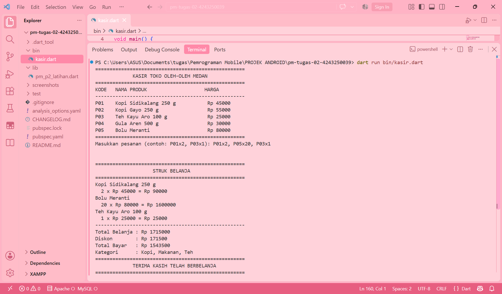
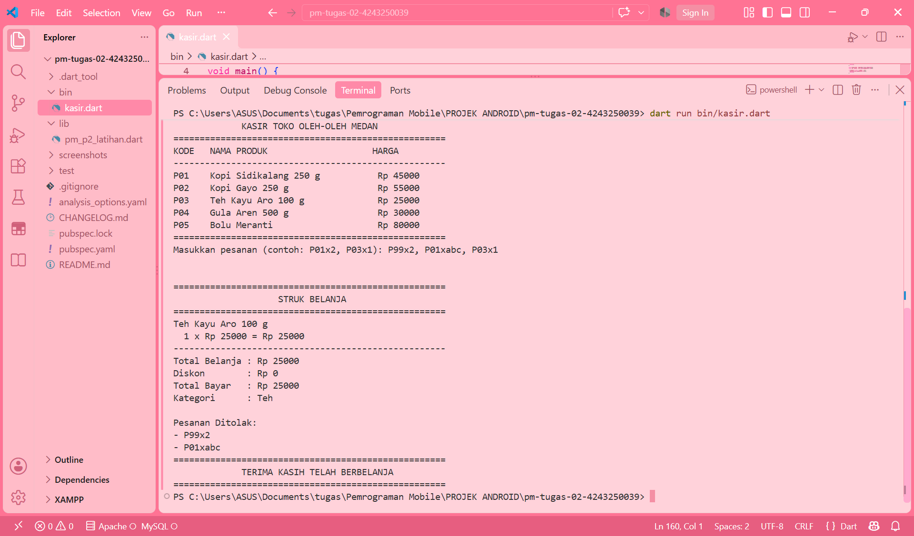

# Aplikasi Console Kasir Sederhana

## Identitas Mahasiswa

- **Nama:** Elga Sari Tanjung
- **NIM:** 4243250039
- **Program Studi:** Ilmu Komputer
- **Mata Kuliah:** Pemrograman Mobile
- **Tugas:** Tugas Rutin 2

## Deskripsi Program

Aplikasi Console Kasir Sederhana merupakan program berbasis bahasa Dart yang dibuat untuk membantu proses transaksi pada toko oleh-oleh di Medan. Program ini dapat menampilkan katalog produk, menerima pesanan pelanggan, memeriksa validitas pesanan, menghitung total belanja, memberikan diskon, dan menampilkan struk pembelian.

## Daftar Produk

| Kode | Nama Produk | Harga |
|---|---|---:|
| P01 | Kopi Sidikalang 250 g | Rp45.000 |
| P02 | Kopi Gayo 250 g | Rp55.000 |
| P03 | Teh Kayu Aro 100 g | Rp25.000 |
| P04 | Gula Aren 500 g | Rp30.000 |
| P05 | Bolu Meranti | Rp80.000 |

## Fitur Program

1. Menampilkan katalog produk menggunakan `Map`.
2. Menampilkan daftar produk dengan format rapi menggunakan `padRight()`.
3. Menerima beberapa pesanan dalam satu baris, misalnya `P01x2, P03x1`.
4. Memisahkan pesanan menggunakan `split()` dan membersihkan spasi menggunakan `trim()`.
5. Memvalidasi kode produk dan jumlah pesanan menggunakan `int.tryParse()`.
6. Menghitung subtotal setiap produk menggunakan `map()`.
7. Menghitung total belanja menggunakan `fold()`.
8. Memberikan diskon sebesar 10% jika total belanja minimal Rp100.000.
9. Mengelompokkan kategori produk yang dibeli menggunakan `Set`.
10. Menampilkan struk belanja dan daftar pesanan yang ditolak.

## Hasil Pengujian Program

### 1. Pengujian Pesanan Valid

Input pesanan:

```text
P01x2, P05x20, P03x1
```

Hasil perhitungan:

| Keterangan | Hasil |
|---|---:|
| Kopi Sidikalang (2 × Rp45.000) | Rp90.000 |
| Bolu Meranti (20 × Rp80.000) | Rp1.600.000 |
| Teh Kayu Aro (1 × Rp25.000) | Rp25.000 |
| **Total Belanja** | **Rp1.715.000** |
| Diskon 10% | Rp171.500 |
| **Total Bayar** | **Rp1.543.500** |

Kategori produk yang dibeli: Kopi, Makanan, dan Teh.

**Screenshot Pengujian Pesanan Valid**



### 2. Pengujian Pesanan Tidak Valid

Input pesanan:

```text
P99x2, P01xabc, P03x1
```

Hasil pengujian:

- `P99x2` ditolak karena kode produk tidak tersedia.
- `P01xabc` ditolak karena jumlah pesanan bukan angka.
- `P03x1` tetap diproses karena merupakan pesanan valid.

**Screenshot Pengujian Pesanan Tidak Valid**



## Penjelasan Konsep Dart dan Null Safety

Dalam program ini, `final` digunakan untuk variabel yang nilainya hanya ditetapkan satu kali, seperti katalog produk, input pelanggan, dan total belanja. `var` merupakan kata kunci untuk membuat variabel dengan tipe data yang disimpulkan secara otomatis oleh Dart berdasarkan nilai awalnya. Sementara itu, `const` digunakan untuk membuat nilai konstan yang sudah diketahui saat kompilasi. Program ini menggunakan `final` dan tidak menggunakan `var` serta `const` secara langsung.

Null safety diterapkan untuk mencegah kesalahan akibat nilai null. Contohnya, `stdin.readLineSync() ?? ''` memastikan input memiliki nilai kosong jika tidak ada masukan. Selain itu, `int.tryParse()` digunakan untuk mengubah jumlah pesanan menjadi angka. Jika masukan bukan angka, hasilnya adalah `null`, sehingga program dapat menolak pesanan tersebut tanpa mengalami error. Data produk juga diperiksa menggunakan kondisi `produk == null` sebelum dimasukkan ke keranjang.

## Pemeriksaan Program

Pemeriksaan kode dilakukan menggunakan perintah:

```bash
dart analyze
```

Hasil pemeriksaan:

```text
No issues found!
```

Program juga telah diuji menggunakan pesanan valid dan tidak valid, dan keduanya berjalan sesuai harapan.

## Pernyataan Penggunaan AI

AI digunakan sebagai alat bantu dalam memahami konsep pemrograman Dart, dan memperbaiki kesalahan kode. Kode program tetap dijalankan dan diuji secara langsung oleh mahasiswa.

## Kesimpulan

Aplikasi Console Kasir Sederhana berhasil dibuat menggunakan bahasa pemrograman Dart. Program dapat menampilkan katalog produk, memproses beberapa pesanan sekaligus, memvalidasi input, menghitung subtotal menggunakan `map()`, menghitung total menggunakan `fold()`, memberikan diskon, serta menampilkan kategori produk menggunakan `Set`. Program juga dapat menangani pesanan tidak valid tanpa menghentikan proses aplikasi.